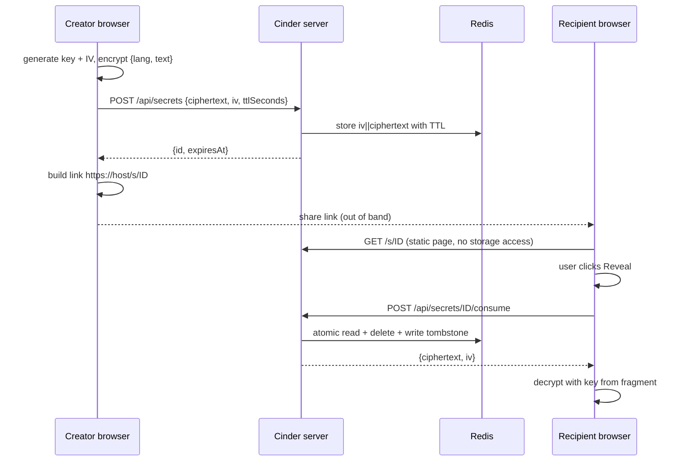

<p align="center"></p>

# Cinder

Cinder is a self-hosted, **burn-on-read** secret sharing tool. Paste a secret, get a link, send it. The first person to open the link and click **Reveal** sees the secret once; after that it is gone.

## Features

- **Burn on read**: the secret is read and deleted in one atomic step. Link previews and scanners cannot burn it, because only an explicit **Reveal** click consumes it.
- **Client-side encryption**: AES-256-GCM in the browser (WebCrypto). The key lives in the URL fragment (`#key`), which browsers do not send to the server. The server only stores ciphertext.
- **Markdown and code**: secrets may be markdown with a selectable code language. Rendering uses a sanitising DOM-building renderer (no `innerHTML`, no images, links limited to http/https/mailto). Copy returns the raw source.
- **QR code**: generated client-side only (vendored library, no third-party service) and hidden behind a **Show QR code** button.
- **Dark mode by default**, with a theme toggle.
- **Tombstones**: after a secret is read, a content-free marker stays until the original expiry, so "already viewed" (possible interception) is distinguishable from "expired".
- **Limits**: TTL presets of 5 minutes, 1 hour, 1 day (default) or 7 days (max); 64 KiB per secret by default (the whole encrypted `{lang, text}` envelope, configurable up to 1 MiB).
- Single Go binary with an embedded static frontend (plain ES modules, no build step, no CDN, no inline scripts or styles).

## How it works



1. The browser generates a random AES-256-GCM key and IV, encrypts the envelope, and sends only ciphertext and IV. The server assigns the 22-character ID.
2. The link is `https://host/s/<id>#<key>`. The recipient page reads the key from the fragment and scrubs it from the address bar (`history.replaceState`).
3. `GET /s/<id>` returns the same static page for every ID and never touches storage.
4. `consume` is a Lua script in Redis that reads, deletes, and writes the tombstone atomically. Exactly one concurrent consume succeeds.
5. Later visits get `410 already_viewed` until the original expiry, then `404 not_found`.

## Quick start (Docker Compose)

```sh
docker compose up --build
```

Open <http://localhost:8080> (set `CINDER_HOST_PORT` to use another host port). Compose starts Cinder and Redis 7. The Cinder port is published on `127.0.0.1` only. Redis is not published and has no data volume; its config is mounted from `deploy/redis.conf`.

Plain HTTP works on `localhost` only. Anywhere else you need HTTPS (WebCrypto requires a secure context); see [Deployment](#deployment).

## Running locally

Requirements:

- **Go**: the version in `go.mod` (currently `go 1.26.0`).
- **Node 22+**, only for the frontend unit tests (no npm dependencies, no build step).
- **Redis 6.2+**, optional for local development.

```sh
make run      # go run ./cmd/cinder
make build    # go build -o bin/cinder ./cmd/cinder
make test     # go test ./...
make vet      # go vet ./...
```

**Store selection** (`cmd/cinder/main.go`):

- Cinder uses the **in-memory store** when `CINDER_REDIS_URL` is unset or empty, or when `CINDER_STORE=memory`. It logs a warning and all secrets are lost on restart. This is for development only.
- Otherwise it uses **Redis** at `CINDER_REDIS_URL`.

```sh
go run ./cmd/cinder                                        # memory store, :8080
CINDER_REDIS_URL=redis://localhost:6379/0 go run ./cmd/cinder   # Redis
```

## Configuration

All settings are environment variables. Invalid values make the process exit with an error (see `internal/config/config.go`).

| Variable | Default | Description |
|---|---|---|
| `CINDER_ADDR` | `:8080` | Listen address (`host:port` or `:port`). |
| `CINDER_REDIS_URL` | `redis://localhost:6379/0` | `redis://` or `rediss://` URL. If the variable is unset or empty, the in-memory store is used (see above). |
| `CINDER_STORE` | unset | Set to `memory` to force the in-memory store. |
| `CINDER_MAX_CIPHERTEXT_BYTES` | `65536` | Max ciphertext size, 1 to 1048576. Covers the whole envelope including the 16-byte GCM tag. |
| `CINDER_TRUSTED_PROXIES` | empty | Comma-separated IPs/CIDRs of reverse proxies whose `X-Forwarded-For` / `X-Forwarded-Proto` are honoured. |
| `CINDER_ALLOWED_ORIGINS` | empty | Comma-separated extra `scheme://host[:port]` origins accepted on `consume`. |
| `CINDER_RATE_LIMIT_CREATE_PER_MIN` | `30` | Per-IP creates per minute; `0` disables. |
| `CINDER_RATE_LIMIT_CONSUME_PER_MIN` | `60` | Per-IP consumes per minute; `0` disables. |
| `CINDER_RATE_LIMIT_STATUS_PER_MIN` | `120` | Per-IP status checks per minute; `0` disables. |
| `CINDER_RATE_LIMIT_BURST` | `10` | Token bucket burst size (minimum 1). |

Numeric rate-limit values must be at most 1000000.

## API summary

Binary values are base64url without padding. Full contract: [docs/api.md](docs/api.md).

| Method and path | Purpose |
|---|---|
| `POST /api/secrets` | Create. Body `{ciphertext, iv, ttlSeconds}`; `ttlSeconds` is one of 300, 3600, 86400, 604800. Returns `201 {id, expiresAt}`. |
| `GET /api/secrets/{id}/status` | Non-destructive. `200 {state: "available", expiresAt}`, `410 already_viewed`, or `404 not_found`. |
| `POST /api/secrets/{id}/consume` | Atomic read and burn. Requires a matching `Origin` header and body `{}`. Returns `{ciphertext, iv, expiresAt}`. |
| `GET /s/{id}` | Static view page, identical for every ID, never touches storage. |
| `GET /healthz` | `200 {"status":"ok"}` if Redis answers `PING`, else `503`. |

Errors use `{"error": {"code", "message"}}`. All `/api/*` responses are `Cache-Control: no-store`.

## Security model

**What the design provides**

- The server, its logs, and Redis only ever see ciphertext, IV, and ID. The key is in the URL fragment and never sent to the server. Logs never record bodies, ciphertext, or full IDs.
- Whoever holds the **full link** can read the secret, once. "Already viewed" signals that someone else may have opened it first.
- Strict headers on all responses: CSP (`default-src 'none'; script-src 'self'; style-src 'self'; ...`), `Referrer-Policy: no-referrer`, `nosniff`, COOP, `X-Robots-Tag: noindex`, HSTS when served over HTTPS.
- `consume` checks `Origin`; per-IP rate limits and body limits are applied.

**Honest limitations**

- **A malicious or compromised operator can serve altered JavaScript** and capture secrets and keys. End-to-end encryption does not protect against the party that delivers the code. Self-host and review what you run.
- **A lost response burns the secret.** Consume is atomic with no grace window; if the response is lost after the burn, the recipient sees "already viewed" and the creator must send a new secret.
- **Redis persistence is off by design** (`deploy/redis.conf`), so restarting Redis loses all unread secrets. Enabling RDB/AOF, replicas, or backups can retain ciphertext after deletion.
- Anyone who sees the full link (chat history, shoulder surfing) can read it; a compromised recipient device or a recipient copying the secret is out of scope.
- Tombstones reveal that an ID once existed.
- No revoke, passphrase, or creator notification in the MVP.
- Security headers and rate limits are only as good as your proxy setup (see below).

More detail: [docs/design.md](docs/design.md).

## Deployment

Cinder serves plain HTTP. **Terminate TLS in a reverse proxy** (Caddy and nginx examples are in [docs/operations.md](docs/operations.md)). The proxy should:

- Pass the real client IP via `X-Forwarded-For`, and set `CINDER_TRUSTED_PROXIES` to the proxy's address or network. Never trust a range untrusted clients can reach.
- Pass `X-Forwarded-Proto: https` and preserve `Host`, so HSTS and the `Origin` check on `consume` work. If the public origin still differs, add it to `CINDER_ALLOWED_ORIGINS`.
- Limit request bodies (about 128k with the default ciphertext limit, since base64 inflates it by about 4/3), not cache responses, and not log request URLs if avoidable.
- Not retry `consume` requests automatically.

Redis: never expose it publicly, keep persistence off, and do not back it up. Health: probe `GET /healthz` from outside; the runtime image is distroless (no shell, curl or wget), so the container healthcheck runs the `cinder healthcheck` subcommand, which Compose uses for both Cinder and Redis. The container runs as non-root with a read-only filesystem and all capabilities dropped.

## Testing

```sh
go test ./...                 # unit and integration tests (memory store)
node --test                   # frontend tests (Node 22+), run from the repo root
CINDER_TEST_REDIS_URL=redis://localhost:6379/0 go test ./...   # also exercise real Redis
```

- Without `CINDER_TEST_REDIS_URL`, the Redis integration tests in `test/integration` are skipped; the store tests in `internal/store` skip if no Redis is found on `127.0.0.1:6379`.
- Real-browser behaviour (clipboard, canvas QR, theme toggle, CSP enforcement in a browser) is not covered by automated tests.
- CI (`.github/workflows/ci.yml`) runs `go vet ./...` and `go test ./...`. It does not run the Node tests or a Redis service.

## Project layout

```
cmd/cinder/          entrypoint, store selection, Redis wiring
internal/api/        HTTP handlers and error shapes
internal/app/        handler assembly (middleware stack + routes + web)
internal/config/     CINDER_* parsing and validation
internal/idgen/      server-side ID generation
internal/middleware/ security headers, rate limit, body limit, origin, logging, proxy
internal/store/      Store interface, memory and Redis implementations
internal/web/dist/   embedded frontend (source of truth, no build step)
web/test/            Node tests for the frontend
test/integration/    end-to-end HTTP tests
deploy/redis.conf    Redis config used by Compose
docs/                design, API, operations, UI mockups
```

## Contributing

Work is coordinated as described in [AGENTS.md](AGENTS.md) (roles, worktrees, merge policy, decisions log). Design decisions are recorded in [docs/design.md](docs/design.md) and the AGENTS.md decisions log.

## Docs

- [docs/design.md](docs/design.md): decisions, threat model, encryption and UX design
- [docs/api.md](docs/api.md): HTTP API contract, headers, Redis schema
- [docs/operations.md](docs/operations.md): deployment, TLS, Redis, backups
- [web/README.md](web/README.md): frontend layout and tests
