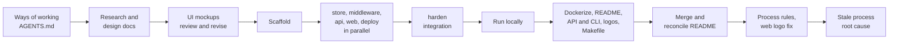

# Cinder timeline: what was asked and what it produced

This page lists what the user asked for, what the coordinator agent delegated, and what landed in the repo. It covers 2026-11-18 13:43 to 2026-11-19 11:08 (UTC+11).

## How this was built (evidence and limits)

Sources used:

- `git log --reverse --date=iso` on `main` (58 commits at the time of writing).
- The `AGENTS.md` Changelog and `docs/design.md`.
- Past chat transcripts. These hold the user's messages with timestamps, plus the coordinator's own summary of the work that was compacted out of the chat.

Limits you should know:

- **Commit times are not ask times.** Branches were rebased before the fast-forward merge. Several commits share one timestamp (for example `14:24:40` and `14:29:45`). Use commit times only as "landed by".
- **Commit hashes in agent reports do not match `main`.** Agents reported hashes from their branches. Rebasing changed them. This page uses the hashes on `main`.
- **Exact ask times are known only for messages the transcripts show.** For asks inside the compacted part of the chat (Dockerize, README, API, logo mockups, Makefile, merge of two branches, todo tool, `mo` rule, web logo) the time is shown as "about", taken from nearby commits.
- **Not found in the transcripts:** the user's words that led to the polling-over-sleep rule (`2708d48`). The rule exists in `AGENTS.md` section 13.
- Nothing here was re-run. Test and run results are what the agents reported, unless marked "(git)".

## Overview

## Phase 1: Ways of working (2026-11-18, 13:43 to 13:48)

| When | User ask | What the coordinator delegated | Result | Notes |
|---|---|---|---|---|
| 13:43 | "You are a coordinator that sends off work to subagents. You never do any work ... use git worktrees ... put our ways of working into an AGENTS.md ... plan the work and then show me the decisions." | One worker agent to write `AGENTS.md`. | `AGENTS.md` sections 1-4 and a Changelog. `AGENTS.md` listed "not a git repo" as an open question. | The agent was told to do nothing else (no `git init`). |
| 13:44 | "yes" (approve `git init`). | An agent ran `git init -b main`. | `e984bfe` chore: initial commit (13:44:44). | Worktrees became possible from here. |
| 13:45 | Open the documentation in the current web browser (`open -A Chrome`). | An agent opened the file. | None in git. | The user typed `-A`. The coordinator's own summary says the correct flag is lowercase `-a`. |

## Phase 2: Research and design (13:48 to 14:03)

| When | User ask | What the coordinator delegated | Result | Notes |
|---|---|---|---|---|
| 13:48 | "Cinder is a tool where we would share secure secrets ... burn on read ... Research how this type of application should be implemented and write some documentation, then open it in my chrome browser." | A research agent (high effort). | `578efa7` docs: add Cinder design research and architecture (`docs/design.md`, `docs/design.html`). | The research came from prior knowledge, not live web lookups. `docs/design.md` says so at the top and lists "Items to verify". `design.html` was made by a script outside the repo (`/tmp/md2html.py`, per the coordinator summary). |
| about 13:55 to 14:00 | Answers to the open design questions (asked in chat; the ask-tool rule came later, at 14:01). | An agent recorded them. | `430abda` docs: record Cinder design decisions. Decisions: Go single binary, self-hosted first, Redis (user chose it over the recommended SQLite), no passphrase, minimal tombstone, no creator notification, 7-day max TTL. | Core design: client-side AES-256-GCM, key in the URL fragment, burn only by `POST /api/secrets/{id}/consume` with an Origin check. |
| 14:01 | "always ask questions using the ask tool" | An agent added the rule. | `b7099bf` docs: add question-asking rule and MVP decisions (server-assigned IDs, no revoke, 64 KiB limit, plain JS). | This is `AGENTS.md` section 7. The coordinator had been asking questions in chat. |

## Phase 3: UI mockups (14:05 to 14:21)

| When | User ask | What the coordinator delegated | Result | Notes |
|---|---|---|---|---|
| about 14:05 | (Mockups were part of the plan.) | A mockup agent (low effort) in its own worktree, branch `docs/ui-mockups`. | `6cf89dd` docs: add static UI mockups, dark mode default (`docs/mockups/`). | Dark mode as the default theme was a user choice. |
| 14:10 | "Lets review the mockups you created, ask me about them individually and I'll tell you about each one." | The coordinator asked about each mockup. An agent revised the mockups. | `96b4388` revise mockups: markdown and code input, QR code, smaller tombstone icon. | Feedback drove new features (markdown with code language, QR code). |
| 14:16 | "Always record decisions without asking. Make the buttons on the create and reveal smaller." | An agent made the buttons smaller and recorded the UI decisions. | `3141a5b` smaller buttons, hidden QR toggle, UI and content decisions recorded. `AGENTS.md` section 9. | This is the second time the user changed how the coordinator works (first was the ask tool). |
| 14:19 | "The reveal secret button didn't shrink to a smaller size." | An agent fixed the interstitial button. | `8f2534f` make Reveal button on interstitial compact. | A correction: the first change missed one screen. |
| 14:20 | "control your thinking level so that planning and big research is high, but feature work and mock is low" | An agent added the rule. | `3a70b67` docs: add thinking-level rule. `AGENTS.md` section 10. | **Mismatch:** the user said feature work is low. `AGENTS.md` section 10 says feature work is MEDIUM. I could not find where this was agreed. Check with the user. |
| 14:21 and 14:22 | "merge away", then "check if it needs anything from it otherwise merge". | A merge agent merged the mockups into `main`. | Mockup commits are on `main` (git). | The merge agent did the merge. The coordinator did not. |

## Phase 4: Build in parallel (14:23 to 14:42)

| When | User ask | What the coordinator delegated | Result | Notes |
|---|---|---|---|---|
| 14:23 | "Lets build it" | `scaffold` agent (T0), then five agents in parallel, each in its own worktree: `store`, `middleware`, `api`, `web`, `deploy`. | **scaffold** (14:24:40): `3e09369`, `528d8bd`, `ce174d5`, `d214b12`, `7ac7fb9`, `b01e253`, `86c27c2`. Go module, frozen `Store` interface, `internal/config`, `internal/idgen`, `docs/api.md`, CI. | The coordinator froze the `Store` interface first so the others could build against it. |
| about 14:25 | (Not stated.) | An agent renamed tasks. | `12a6eb5` docs: name tasks instead of T0-T7. `AGENTS.md` section 11 maps names. | Short names (`scaffold`, `store`, ...) replaced T0-T7. `docs/api.md` still says "frozen by T0". |
| 14:28 to 14:35 | (Same ask.) | See rows above. | **store:** `7b5678f`, `c59e916`, `ab85bee`, `a66f69a` (Redis with Lua, memory store, tests). **middleware:** `6c44b43`, `a4b5a6e`, `08576f6`, `87ae9cb` (headers, rate limit, body limit, logging, origin). **api:** `ad1aa74`, `50ce206`. **web:** `914154a`, `ec53413`, `e435599`, `401de37`, `cc72039` (crypto, sanitising markdown, vendored QR). **deploy:** `38fbea4`, `f42c0a6`, `092f145` (Dockerfile, compose, ops guide, first README). | Plain JS, no build step. Agents reported 26 `node --test` tests passing for `web`. |
| 14:26 and 14:27 | "merge without asking me if it's ready and passes tests", then "Do it all". | A merge agent merged each ready branch (fast-forward, or rebase then fast-forward). | `e273c51` docs: AGENTS.md merge policy and changelog. `AGENTS.md` section 12. | Every branch added a line to the `AGENTS.md` Changelog, so rebases conflicted there. The merge agent kept all lines. I could not tell from the transcripts what "Do it all" answered. |
| 14:37 to 14:39 | (Part of "Do it all".) | `harden` agent (integration). | `9d547bf` wire Redis store, web UI and middleware via `internal/app`; `23e8c36` gofmt; `e7e960d` full-stack integration, CSP and healthz tests. | The coordinator summary says the Redis tests were not run on the last merge run. |
| 14:42 | (Ask text not found.) | An agent added the rule. | `2708d48` docs: AGENTS.md polling-over-sleep rule. Section 13. | |

## Phase 5: Run it locally (14:43)

| When | User ask | What the coordinator delegated | Result | Notes |
|---|---|---|---|---|
| 14:43 | "run the app and open the webpage for me" | An agent ran `CINDER_STORE=memory CINDER_ADDR=:8080 go run ./cmd/cinder` and opened Chrome. | App served on port 8080; `/healthz` returned 200 (per the agent). | **This process (PID 47567) was never stopped. It caused the "old logo" confusion in Phase 8.** |

## Phase 6: Docker, README, API, logos, Makefile (about 14:45 to 14:57)

Five asks were handled in parallel, each on its own branch and worktree. Exact ask times are not in the transcripts. Commit times fall between 14:48 and 14:57.

| When | User ask | What the coordinator delegated | Result | Notes |
|---|---|---|---|---|
| about 14:45 | "Dockerize this app" | Developer agent, branch `feat/dockerize`. | `024114f` `cinder healthcheck` subcommand; `1f1cc72` build on Go 1.26, reachable Redis, container healthchecks, `CINDER_HOST_PORT`. | Bugs found: Dockerfile used `golang:1.22` but `go.mod` needs 1.26; `deploy/redis.conf` bound to loopback so the app could not reach Redis. The agent ran the real stack on port 18080 and reported smoke tests passed. It left the old `go run` process alone because it held port 8080. |
| about 14:45 | "Build a proper README.md for this app with the documentation agent" | Documentation agent, branch `docs/readme`. | `7aa1652` docs: rewrite README. | The agent only read code and ran no tests. It wrote claims about Docker and healthchecks before `feat/dockerize` was merged. Later reconciled. |
| about 14:45 | "Ensure there is a working api so that we can use POST commands to create and fetch passwords" | Developer agent, branch `feat/api-usable`. | `e278ae6` `scripts/cinder-cli.mjs` (Node, browser-compatible AES-256-GCM); `e45c63a` CLI round-trip test; `41047ff` "Using the API with curl" docs; `397e3e3` compose Redis fix. | The agent ran the full curl flow (create, status, consume, second consume gives 410, bad Origin gives 403 and does not burn). It found no API bugs. It could not build the Docker image (network failure at `go mod download`), so it did not verify compose end to end. |
| about 14:50 | "Create mockups of the cinder logo" | Mockup agent, branch `docs/logo-mockups`. | `e2e1c09` docs: add logo mockups (six SVGs in `docs/logos/`). | The agent had not looked at the page when it first reported. |
| about 14:52 | "update the Makefile to add the docker commands" | Developer agent, branch `feat/makefile-docker`. | `7aad7ce` build: add Makefile docker targets (`docker-build`, `docker-run`, `docker-up`, `docker-down`, `docker-logs`, `docker-ps`). | Only `make -n` was run. No Docker build. Merged as a fast-forward straight away. |
| 14:55 | "I've reviewed the logo mockups, can we have a mix of the fire inside the padlock" | Mockup agent. | `4632639` docs: add padlock-flame logo variants (07, 08, 09). | Agent took a headless Chrome screenshot (Chrome only). |
| 14:56 | "lets use 09-padlock-ember-flame ... make sure thats at the top of our README" | Merge agent. | `206f452` `docs/logo.svg`; `fe7cc5c` logo at README top. | Rebasing hit conflicts in the `AGENTS.md` Changelog. All lines were kept. |

## Phase 7: Merge and reconcile (about 14:57 to 15:04)

| When | User ask | What the coordinator delegated | Result | Notes |
|---|---|---|---|---|
| about 14:57 | "yes" (merge `feat/dockerize` and `feat/api-usable` and fix the README). | Merge agent. | `414b729` drop redundant Redis bind flags; `f376c29` reconcile README with Dockerfile, compose, healthcheck, CLI, Makefile. | **Overlap:** `feat/dockerize` and `feat/api-usable` both fixed "Redis unreachable" in different files. The merge agent removed the duplicate flags. Its first try also dropped the `command` line that loads `redis.conf`, then restored it (per agent report). The agent did not run `docker compose up`. |
| about 14:59 | "You now have access to a todo tool use this for all future tasks" | An agent added the rule. | `c13644d` docs: AGENTS.md todo-tool rule. Section 14. | The coordinator later skipped this rule (see lessons). |
| about 15:01 | "Update the logo on the actual page to the new one" | Developer agent. | `6877586` web: use padlock-ember-flame logo in header and favicon. | |
| about 15:03 | "in the future if you want me to read any markdown documentation use `mo --open <filename>`" | An agent added the rule. | `4791bfe` docs: AGENTS.md `mo --open` rule. Section 15. | Then "show me the readme file" (15:04) and "open the docs directory in mo". `mo` printed three URLs on port 6275. |
| 15:07 | "how many commits have been made in this repo?" | An agent counted. | 57 commits at `4791bfe` (checked now with `git rev-list --count`). `main` now has 58. | The 58th commit is `2d64f0d` from Phase 8. |

## Phase 8: The "old logo" problem (about 15:20 to 15:48)

| When | User ask | What the coordinator delegated | Result | Notes |
|---|---|---|---|---|
| about 15:20 | "the main site logo doesn't match the new logo we chose for the readme" | Developer agent (low effort). | `2d64f0d` web: larger header logo (28px to 36px), drop light-theme filter (15:35). | The agent found the three logo files byte-identical. It concluded "stale Docker image". `AGENTS.md` Changelog records that cause. **That cause was wrong.** |
| 15:36 | "run the make docker down/up again" | Developer agent (low effort): `make docker-down`, `make docker-up`, poll until healthy, then curl. | Both services healthy. `/healthz` returned 200. `localhost:8080/static/logo.svg` returned 404. | A second agent found a stale `go run` process (PID 47567, started 14:43) still listening on `*:8080` over IPv6. `localhost` resolved to `::1` first, so the browser reached the old process, not Docker. `127.0.0.1:8080` served the correct logo from the container. |
| 15:48 | "the logo in the page still is the old one. not the new one '09' ... The readme is fine though" | Agent killed the stale process. | PIDs 47567 and 47510 killed. `lsof` then showed only Docker on port 8080. `/static/logo.svg` returned 200. | Nobody looked at the page in a browser. The user's own check is the real confirmation (not recorded here). |

## Phase 9: Workshop docs (2026-11-19, about 11:00 to 11:15)

| When | User ask | What the coordinator delegated | Result | Notes |
|---|---|---|---|---|
| about 11:00 | A timeline of what was asked and what it produced; a plan to turn this into a 90-minute training workshop; a repeatable process other humans can follow. | Workers on branch `docs/workshop` (worktree `Cinder-worktrees/workshop-docs`), then a finish worker. | `docs/workshop/`: `timeline.md`, `workshop-plan.md`, `playbook.md`, `README.md`. | The ask time is approximate. The finish worker checked hashes against `git log` and fixed the docs; it did not rerun the app. |

## What went wrong, and lessons

1. **A stale process hid the real result.** The first dev server stayed alive on port 8080 for about an hour. Docker was fine. Two agents noticed port 8080 was busy and left it alone, but nobody told the user. Lesson: before you test a service, check what listens on the port (`lsof -nP -iTCP:8080 -sTCP:LISTEN`). Stop dev servers when the task ends.
2. **The first diagnosis was a guess.** "Stale Docker image" was stated as the cause and written into the `AGENTS.md` Changelog before anyone checked the port. The real cause was found after two more attempts. Lesson: verify the cause before you write it down. If you record a wrong cause, add a correction.
3. **Two branches fixed the same Redis problem.** `feat/dockerize` changed `redis.conf`. `feat/api-usable` changed compose flags. Both landed and had to be reduced to one fix (`414b729`). Lesson: give one owner to each shared file or concern. Check for overlap before you dispatch parallel work.
4. **Agents claimed things they did not check.** Examples: README claims about healthchecks and hardening written before the code merged; tests not run for README, Makefile and logo tasks; a Docker build that failed in one sandbox; "all three SVGs render" checked in Chrome only. Lesson: require every report to separate "ran" from "did not run" (see `playbook.md`).
5. **The coordinator skipped its own todo rule.** `AGENTS.md` section 14 says to use the todo tool for all tasks. The coordinator skipped it in three tasks in Phase 8 (it said so in each report). One reason it gave: the task was small. Lesson: rules that are optional "for small tasks" are not followed. Make the rule small enough to always follow, or drop it.
6. **Shared changelog file caused conflicts.** Every branch appended a line to `AGENTS.md`, so every rebase conflicted. Merge agents kept all lines. Lesson: append-only shared files need a merge rule, or one owner who writes them after merge.
7. **Stray worktree paths.** Some early agents used `/Users/nchand/Workspace/Cinder-worktrees` instead of `../Cinder-worktrees` (from the coordinator summary). Lesson: give the exact absolute worktree path in every prompt.
8. **Rules drifted.** The user said "feature work and mock is low", the recorded rule says feature work is MEDIUM. Lesson: read recorded rules back to the user once.
9. **Research was from memory.** The design doc says so. Treat it as a draft until sources are checked.
10. **Tooling hiccups.** The coordinator summary says foreground calls to one subagent type failed with a provider error, so later work used a different subagent tool. The chat was also compacted at about 15:32, which lost detail (this page had to rebuild some of it).

## Unverified items

- Whether the user now sees the new logo in the browser. Agents checked the HTML and the served file only.
- TLS, trusted proxy and HSTS behaviour end to end.
- Rate limiting through the full stack.
- Docker image on non-native architectures; image size; vulnerability scan.
- CI against the Go 1.26 change. CI runs `go vet` and `go test` only (no Node tests, no Redis service).
- Browsers other than Chrome.
- Design docs still use the old task names: `docs/api.md` line 1 says "frozen by T0" (checked). Other docs were not searched.
- The `AGENTS.md` Changelog line for `web-logo-fix` still names "stale Docker image" as the root cause. It has not been corrected (checked at 2026-11-19). The real cause is in Phase 8.
- The exact time of the Phase 6 and Phase 7 user asks.
