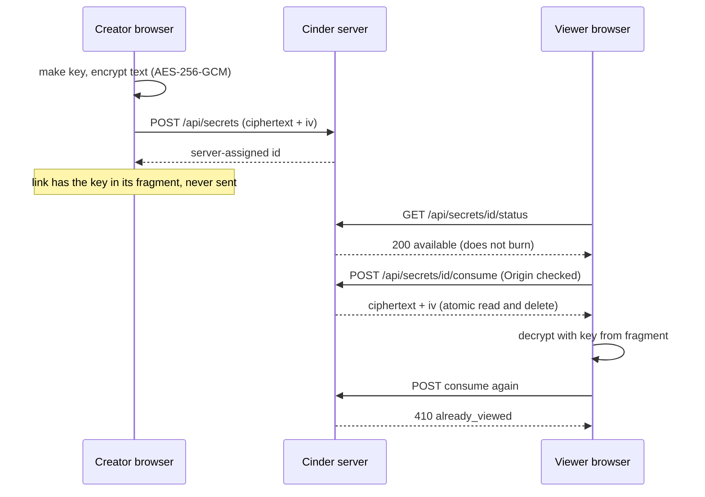
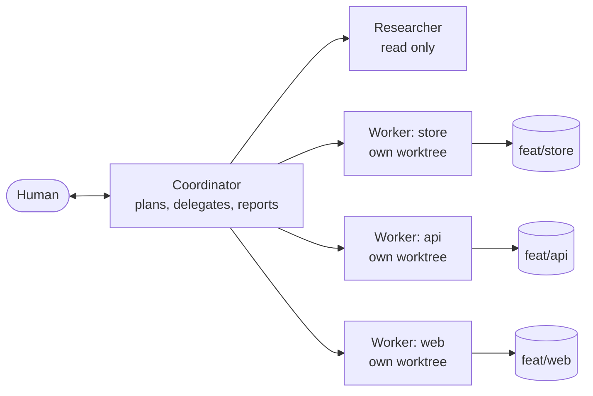
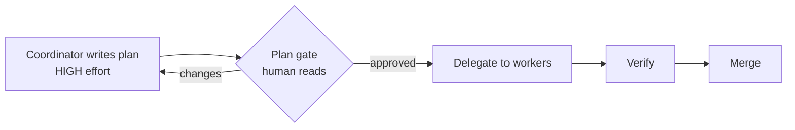
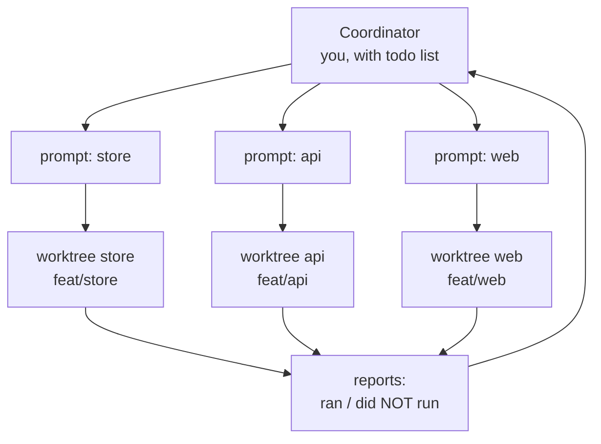
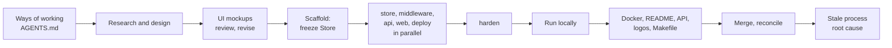

# Build an app with a coordinator agent and subagents

Worked example: **Cinder**, a burn-on-read secret sharing app

<span class="tag">90 minutes</span> <span class="tag">pairs</span> <span class="tag">hands-on</span>

<!--
SECTION 1: Welcome and pre-flight. 00:00 to 00:08 (8 min).
00:00 Welcome. Say the rule aloud: "Show me the command you ran."
Check the clock is visible. Remote option: add a 5 min break at 00:35 (95 min total).
-->

---

# Why this workshop

Cinder was built by a **coordinator agent** that planned the work, sent tasks to **subagents** in separate **git worktrees**, and reported back to a human.

- The exercise also went wrong in useful ways. We will show those too.
- You leave with **one working habit**, not a finished app.
- Everything here comes from `docs/workshop/` in the Cinder repo: timeline, plan, playbook.

<!--
00:00 to 00:02. Keep it short. The point: this is a real project, with real mishaps.
-->

---

# Learning objectives

After today, you can:

1. Explain **coordinator vs workers**, and why the coordinator does not write code.
2. Use **one worktree per writing agent**.
3. Hold a **plan gate**: read the plan, approve it, then build.
4. Write a **delegation prompt** (context, task, constraints, effort, branch, checks, report format).
5. **Verify** a report with your own commands, and name what the agent did not check.
6. **Merge** a finished branch with a short, repeatable procedure.

<!--
00:02. Read these quickly. They map one to one to the six concepts and the exercise.
-->

---

# Agenda: 90 minutes

| Min | Clock | Block |
|---:|---|---|
| 8 | 00:00 to 00:08 | Welcome and pre-flight |
| 12 | 00:08 to 00:20 | Concepts (six ideas) |
| 15 | 00:20 to 00:35 | Guided demo |
| 45 | 00:35 to 01:20 | Hands-on in pairs |
| 10 | 01:20 to 01:30 | Debrief |

<!--
00:02 to 00:03. Show the agenda. Remote version: 95 minutes with a break at 00:35.
-->

---

# Ground rules and pre-flight

> The agent says it works. **Show me the command you ran.**

Run in the starter repo. Every line must pass:

```bash
git --version                      # 2.30 or newer
go version                         # go1.22 or newer
git worktree list                  # shows the main checkout only
go build ./... && go test ./...    # build works; some starter tests fail on purpose
lsof -nP -iTCP:8080 -sTCP:LISTEN   # prints nothing
```

Form pairs. Say "green" in chat when done.

<!--
00:03 to 00:08. Form pairs. Pairs run the pre-flight check. Ask for a screenshot or "green" in chat.
Expected: build passes; tests fail only in the three packages the exercise will fix.
Late arrivals: spare laptop. Port 8080 must be free: this matters later (see debrief).
-->

---

# The worked example: Cinder

A self-hosted tool to share secrets that **burn on read**.

- Client-side **AES-256-GCM**. The key lives in the URL fragment (`#key`), which browsers do not send.
- The server stores only ciphertext. Go single binary, Redis, plain JS frontend.
- Only an explicit **Reveal** click consumes the secret. Link previews cannot burn it.

Your exercise uses `cinder-mini`: a small slice of this.

<!--
Optional, about 1 min. Not in the workshop-plan run sheet: show it on the projector while pairs finish the pre-flight (00:03 to 00:08), or skip it. Do not add it to the clock.
Facts are from README.md and docs/design.md.
-->

---

# Burn on read: the sequence



<!--
Optional, about 1 min, same rule as the previous slide (not on the run sheet; skip if late). Shared vocabulary for the exercise: GET must never burn; consume is POST only.
These are Cinder's real paths (README.md flow and API table, docs/api.md). The cinder-mini starter uses shorter routes (/secrets), see the hands-on slides.
-->

---

# Concept 1: coordinator vs workers



The coordinator **never edits code**. Why: plan and work stay separate, so you can check each one.

<!--
SECTION 2: Concepts. 00:08 to 00:20 (12 min). Six ideas.
00:08 to 00:10 (2 min). Cinder AGENTS.md section 1: "coordinator only. It never researches, builds, edits code, or merges."
-->

---

# Concept 2: worktrees

One writing agent, one worktree, one branch.

```bash
git worktree add /abs/path/myapp-worktrees/store -b feat/store
git worktree add /abs/path/myapp-worktrees/api   -b feat/api
git worktree list
```

- Parallel agents cannot overwrite each other.
- Always give the **absolute path** (some early Cinder agents used the wrong folder).
- Create worktrees from an up-to-date `main`, after shared interfaces are frozen.

<!--
00:10 to 00:12 (2 min). Show git worktree add live if possible.
-->

---

# Concept 3: plan first



Plan has: goal, tasks (name, branch, owner), **file ownership**, what is frozen first, checks, risks.

Small tasks may skip it. Big ones never.

<!--
00:12 to 00:14 (2 min). In Cinder the coordinator froze the Store interface first (scaffold), then five agents ran in parallel.
Review questions: can each task finish alone? does a file have two owners? is every done-check a command?
-->

---

# Concept 4: delegation prompts and effort

A worker knows nothing about your chat. Seven parts:

1. **Context** (repo path, decisions, frozen things)
2. **Task** (files owned, out of scope)
3. **Constraints**
4. **Worktree and branch** (absolute path)
5. **Checks to run**
6. **Report format** ("ran" and "did NOT run")
7. **Do not push, do not merge**

Effort on line 1: planning **HIGH**, feature work **MEDIUM**, simple tasks and mockups **LOW**.

<span class="small">Cinder's own history: the user said "feature work is low"; the recorded rule says MEDIUM. Never reconciled with the user. See Mishap 5.</span>

<!--
00:14 to 00:17 (3 min). The tool may have no effort setting, so write it in the prompt.
Open question to be honest about: the user said "feature work and mock is low" in chat (14:20); AGENTS.md section 10 says feature work is MEDIUM. The timeline could not find where that was agreed, and workshop-plan open question 9 is still open. The workshop uses MEDIUM (as the playbook does). Lesson: read recorded rules back to the human.
-->

---

# Concept 5: merge policy and decisions log

- Agents **never merge** on their own. A merge step runs only when tests pass.
- Rebase on `main`, then fast-forward only.
- Decisions go in a log in the repo (`AGENTS.md`).

```bash
git -C <worktree> rebase main
git merge --ff-only feat/<task>
git branch -d feat/<task> && git worktree remove <worktree>
```

Cinder choice: a **merge agent** merges ready branches without asking (user instruction, 2026-11-18).

<!--
00:17 to 00:19 (2 min). Choose one policy in your own AGENTS.md: human merges, or a merge agent.
Every branch appends to the AGENTS.md changelog, so rebases conflict: keep all lines.
-->

---

# Concept 6: trust but verify

Reports can be wrong. Ask: **what did you not check?**

- Require "ran" vs "did NOT run" in every report.
- Check what is **really listening** on the port.
- Rebuild Docker after a code change.
- A human checks anything visual.

```bash
lsof -nP -iTCP:8080 -sTCP:LISTEN
```

<!--
00:19 to 00:20 (1 min). Teaser: "One stale process hid a correct build for about an hour. We will show it in the debrief." Do not tell the whole story now.
-->

---

# Guided demo: one cycle on a tiny task

Task: **add a `/version` endpoint.** Todo list visible.

<span class="small">Illustrative demo task from the workshop plan. Cinder has no `/version` endpoint; use any tiny task.</span>

| Step | Min |
|---|---:|
| 1. Create worktree and branch | 1 |
| 2. Plan and approval | 3 |
| 3. Delegation prompt to one worker | 3 |
| 4. Read the report, find one unchecked item | 3 |
| 5. Verification checklist | 3 |
| 6. Merge and clean up | 2 |

<!--
SECTION 3: Guided demo. 00:20 to 00:35 (15 min).
Clock: 00:20 worktree and branch; 00:21 plan and approval; 00:24 delegation prompt; 00:27 report, find one unchecked item; 00:30 verification; 00:33 merge and clean up.
Rehearse once within 24 hours. Have the finished result ready if the live run is slow.
Contingency: shorten to 10 min by skipping merge and showing it in the debrief.
-->

---

# Demo 1 and 2: worktree, plan, approval

```bash
git worktree add /abs/path/demo-worktrees/version -b feat/version
```

Coordinator plan (HIGH effort), human replies "approved":

- Goal: `GET /version` returns the build version.
- One task, one owner, files listed.
- Check: a `curl` that returns 200.

**No approval, no building.**

<!--
00:20 to 00:24. Narrate: the todo list first, then the plan. Change one small thing in the plan so people see the gate is real.
-->

---

# Demo 3: the delegation prompt

```text
# Illustrative prompt for a demo repo (paths and files are made up)
Effort: MEDIUM.
CONTEXT   Repo /abs/path/demo. Read AGENTS.md first.
TASK      Add GET /version. Owns: api/version.go. Out of scope: store.
CONSTRAINTS  Go standard library only.
WORKTREE  /abs/path/demo-worktrees/version, branch feat/version
CHECKS    gofmt -l . ; go build ./... ; go vet ./... ; go test -race ./...
REPORT    1 branch  2 commits  3 files  4 what I ran
          5 what I did NOT run  6 problems and decisions
DO NOT push. DO NOT merge.
```

<!--
00:24 to 00:27. Point out each of the seven parts. Effort on line 1.
-->

---

# Demo 4 and 5: read the report, then verify

Read the report before the code:

- All six sections? Is "did NOT run" honest? Empty is a warning.
- Do the hashes exist? Any files outside the owned list? Any push or merge?

Then run it yourself:

```bash
gofmt -l . && go build ./... && go vet ./... && go test -race -count=1 ./...
lsof -nP -iTCP:8080 -sTCP:LISTEN     # before and after
curl -i http://127.0.0.1:8080/version   # illustrative demo route, not a Cinder API
```

<!--
00:27 to 00:33. Find one thing the worker did not check, and say it out loud. Then run the checklist.
Do not rely on the report. Check that the process answering the port is the one you started.
-->

---

# Demo 6: merge and clean up

```bash
git -C /abs/path/demo-worktrees/version rebase main
# re-run checks
git merge --ff-only feat/version
git branch -d feat/version
git worktree remove /abs/path/demo-worktrees/version
git worktree list        # main checkout only
```

Conflict in the `AGENTS.md` changelog? **Keep every line.** Remove only the markers.

<!--
00:33 to 00:35. If running late, skip and show in the debrief.
-->

---

# Hands-on: the brief (cinder-mini)

A tiny burn-on-read store. Go standard library, about 150 lines. No encryption, Redis or Docker.

<span class="small">The starter repo is planned, not built yet. Task names and done checks come from the workshop plan.</span>

| Task | Branch | Done when |
|---|---|---|
| `store` | `feat/store` | `Consume` is atomic (first call wins, then `ErrAlreadyViewed`), TTL expiry. `go test ./store` passes with `-race` |
| `api` | `feat/api` | Three handlers done. `GET` never burns. `go test ./api` passes |
| `web` | `feat/web` | Page creates a secret and shows the link. Create returns an id (check with `curl`) |

You are the **coordinator**. Three workers, three worktrees. The `Store` interface is **frozen**.

<!--
SECTION 4: Hands-on in pairs. 00:35 to 01:20 (45 min).
00:35 exercise starts: read the brief, make the todo list.
Design notes: store and api depend on the frozen interface only, so they run in parallel. web is the safe win. All three append an AGENTS.md changelog line on purpose, to cause a real merge conflict.
Remote: breakout rooms of 2, one facilitator per 5 pairs.
-->

---

# Hands-on: 45-minute sub-schedule

| Min | Step | Output |
|---:|---|---|
| 5 | Read brief and `AGENTS.md`; todo list | 5+ todo items |
| 10 | **Plan gate** | Approved plan with effort levels |
| 15 | Delegate: three prompts, three worktrees | Three branches with commits |
| 10 | Verify and merge one by one | `main` has all three; tests pass |
| 5 | Run and check with `curl`; check port 8080 | Pasted `curl` output |

Driver and navigator switch at the plan gate and at verify time.

<!--
Clock: 00:35 brief and todo; 00:40 plan gate (walk the room, check each plan); 00:50 delegate and start workers (call time every 5 min); 01:05 verify and merge; 01:15 run and check with curl, check port 8080; 01:20 debrief.
Say each step aloud. Keep a visible clock. Do not fix things for pairs: point to the playbook section.
-->

---

# Plan gate (00:40 to 00:50)

The coordinator writes the plan. You **read it, change one thing, approve it**.

Check:

- [ ] Can each task finish without waiting for another?
- [ ] Does any file have two owners?
- [ ] Is every "done" check a command someone can run?
- [ ] Effort level on each task?

> A wrong plan is cheaper to fix than wrong code.

<!--
Walk the room. A facilitator checks every plan. This and verification are the two things you never cut.
-->

---

# Delegate and watch (00:50 to 01:05)



Absolute paths. "Do not push, do not merge." While they run, read the diffs.

<!--
Call time every 5 minutes. Common problem: two agents editing the same file: stop one, move the shared piece into the frozen interface. Agent merges on its own: check git log and git remote -v.
-->

---

# Verify and merge (01:05 to 01:15)

For each branch, **your** commands:

```bash
cd /abs/path/<worktree>
gofmt -l .                 # prints nothing
go build ./... && go vet ./... && go test -race -count=1 ./...
git diff --stat main...HEAD
```

Then merge **one at a time**: store first, then api, then web. Rebase, re-check, `--ff-only`.

Changelog conflict: **keep all lines.** Run the build after.

<!--
Pairs switch driver/navigator here. Order: merge what others depend on first.
-->

---

# Run and check (01:15 to 01:20)

```bash
# cinder-mini starter routes. Real Cinder uses /api/secrets and `go run ./cmd/cinder`
lsof -nP -iTCP:8080 -sTCP:LISTEN          # who owns the port?
go run . &                                  # note the pid
curl -s -X POST http://127.0.0.1:8080/secrets -d '...'      # returns id
curl -s -X POST http://127.0.0.1:8080/secrets/<id>/consume  # secret
curl -si -X POST http://127.0.0.1:8080/secrets/<id>/consume # must fail
kill <pid>; lsof -nP -iTCP:8080 -sTCP:LISTEN                # prints nothing
```

Paste the output. **Stop your server** is part of done.

<!--
Illustrative: the starter repo does not exist yet (workshop-plan open question 3). Paths (plan: POST /secrets, GET /secrets/{id}/status, POST /secrets/{id}/consume) and request bodies must be adjusted to the real cinder-mini before the day. Cinder itself uses /api/secrets and needs an Origin header on consume.
Shared machine: give each pair a port (PORT=8081, ...).
-->

---

# Done criteria (self-check)

- [ ] Coordinator did not edit code; all commits come from worker branches
- [ ] Three worktrees, one per task
- [ ] Plan approved before workers started
- [ ] Each prompt has all seven parts
- [ ] `gofmt -l .` empty; build, vet, `go test -race ./...` pass on `main`
- [ ] A consumed secret cannot be read again; `GET` never burns
- [ ] You can name one thing you checked and one you did not

Nice to have: a decision logged, a review task, worktrees cleaned up.

<!--
Stretch goal for fast pairs: a fourth review agent reviews the combined diff and reports risks.
-->

---

# Debrief: what really happened in Cinder



<!--
SECTION 5: Debrief. 01:20 to 01:30 (10 min).
01:20 each pair names one unchecked claim. Reveal the solution branch. 01:27 feedback form (3 questions). 01:30 end.
Time budget: the run sheet gives 7 minutes (01:20 to 01:27) before feedback, so pick 2 or 3 mishap slides, not all five. The plan does not list these slides explicitly; this is a suggestion.
This diagram is from docs/workshop/timeline.md. User asks were real; build ran 2026-11-18 13:43 to 15:48 (UTC+11).
-->

---

# Mishap 1: the stale process

- 14:43: an agent ran `go run` on `:8080` for "run the app". It was **never stopped** (PID 47567).
- Later, Docker was rebuilt and healthy. But `localhost:8080/static/logo.svg` gave 404.
- `localhost` resolved to `::1` first. The old process listened on `*:8080` over IPv6, so the browser hit it, not Docker.
- `127.0.0.1:8080` served the correct logo from the container.
- Killed the old PIDs. `lsof` then showed only Docker, and `/static/logo.svg` returned 200.
- This is the agents' finding. The user's own browser check was not recorded.

**Lesson:** check what listens on the port before and after you test. Stop dev servers.

<!--
From timeline Phase 5 and 8. Two agents had noticed the port was busy and left it alone, and nobody told the user.
It hid a correct build for about an hour.
-->

---

# Mishap 2: the first diagnosis was a guess

- The user said the site logo did not match the README logo.
- An agent found the logo files byte-identical and wrote **"stale Docker image"** as the cause, into the `AGENTS.md` changelog.
- It was **wrong**. The real cause was the stale `go run` process.
- At the time of the timeline the changelog line was still uncorrected.

**Lesson:** verify the cause before you write it down. If you recorded a wrong one, add a correcting line.

<!--
Honest note: the changelog line for web-logo-fix still names "stale Docker image" on this branch. Ask the room: how would your process catch this?
-->

---

# Mishap 3: claims that were not checked

- **README stale claims:** the README agent only read code and ran nothing. It described Docker and healthchecks before `feat/dockerize` merged. Later reconciled.
- **Makefile:** only `make -n`, no Docker build.
- **API agent:** Docker build failed on network at `go mod download`, so compose was not verified end to end.
- **Logos:** "renders" checked in Chrome only.
- **Redis tests** were not run on the last merge run (coordinator summary).

**Lesson:** every report separates **ran** from **did NOT run**.

<!--
Exercise: ask each pair to name one thing their agent did not check. Collect two or three out loud.
-->

---

# Mishap 4: two fixes for one problem

`feat/dockerize` changed `redis.conf`. `feat/api-usable` changed compose flags. Both fixed "Redis unreachable" in different files.

- The merge agent reduced them to one fix (`414b729`).
- Its first try also dropped the `command` line that loads `redis.conf`, then restored it (per agent report).
- It did not run `docker compose up`.

**Lesson:** one owner per file **and per concern**. Check overlap before parallel dispatch.

<!--
Hash 414b729 is on main (verified with git log).
-->

---

# Mishap 5: the coordinator broke its own rule

- `AGENTS.md` section 14: use the todo tool for all tasks.
- The coordinator skipped it in **three tasks** in the old-logo debugging phase, and said so in each report. One reason it gave: the task was small.
- Also: stray worktree paths, and a rule that drifted ("feature work low" vs MEDIUM, still not settled with the user).

**Lessons**

- A rule that is optional "for small tasks" tends not to be followed. Keep rules small enough to always follow, or drop them.
- Add a rule only when something goes wrong.
- Read new rules back to the human once.

<!--
Source: timeline lessons 5, 7, 8.
-->

---

# What we have not verified (Cinder)

- Whether the user now sees the new logo in the browser (agents checked HTML and the served file)
- TLS, trusted proxy and HSTS end to end
- Rate limiting through the full stack
- Docker on other architectures, image size, vulnerability scan
- CI against Go 1.26 (CI runs `go vet` and `go test` only)
- Browsers other than Chrome
- Research doc was written from memory, not live sources

Honest lists are a feature.

<!--
Source: timeline "Unverified items". Say it plainly: a good report names its gaps.
-->

---

# The cheat sheet

1. Todo list first.
2. Plan (HIGH). Human approves.
3. Freeze interfaces on `main`.
4. One worktree per writer, absolute paths.
5. Seven-part prompts, effort on line 1.
6. Read each report: "did NOT run".
7. Verify with your own commands.
8. Merge one at a time: rebase, fast-forward.
9. Record decisions. Clean up.

**Never:** push or merge from a worker; two agents in one file; "it works" without output; a dev server left running.

<!--
01:20 to 01:27. Hand out playbook.md cheat sheet. Reveal the solution branch and compare with pairs' plans.
-->

---

# Take-home: use it on Monday

- Add an `AGENTS.md` to a repo (template in the playbook).
- Next feature: todo list, plan gate, one worktree, one prompt with a "did NOT run" section.
- Repeat with your own app idea: three lines of intent, research, decide, mock up, freeze, build in parallel, harden, run for real, close.

Materials: `docs/workshop/playbook.md`, `workshop-plan.md`, `timeline.md`.

<!--
Handouts: cheat sheet, prompt template, verification checklist, AGENTS.md template, pre-flight, exercise brief, failure modes, feedback form.
-->

---

# Feedback (3 questions, 2 minutes)

1. What will you use on Monday?
2. What was unclear?
3. What would you drop?


Thank you.

<!--
01:27 to 01:30. Paper or form. Collect timings that ran over. After the run: update plan and playbook, remove worktrees and branches on the facilitator machine.
-->

---

# Backup: failure modes

<div class="text-sm">

| Problem | What to do |
|---|---|
| Stale process on 8080 | `lsof -nP -iTCP:8080 -sTCP:LISTEN`; stop it; use `127.0.0.1` |
| Port clash between pairs | Give each pair a port |
| Changelog merge conflict | Keep every line; run the build |
| Claims success without running | Ask for commands and output; re-run |
| Two agents, same file | Stop one; freeze shared piece; one owner |
| Agent merges or pushes | "Do not push, do not merge" in every prompt; check `git log`, `git remote -v` |
| Wrong worktree place | Absolute path; `git worktree list` |

</div>

<!--
Backup slide. Use as needed during the hands-on block.
-->

---

# Backup: if you are running late

Cut in this order:

1. Concepts to 8 minutes (effort detail goes in the handout)
2. Demo to 10 minutes (skip merge; show in debrief)
3. Two tasks only: drop `web`
4. Skip "run and check"; facilitator shows it once
5. Debrief to 5 minutes; feedback by form

**Never cut:** the plan gate and the verification step.

<!--
Extra time (up to 10 min): run the stretch review task or compare plans.
-->
